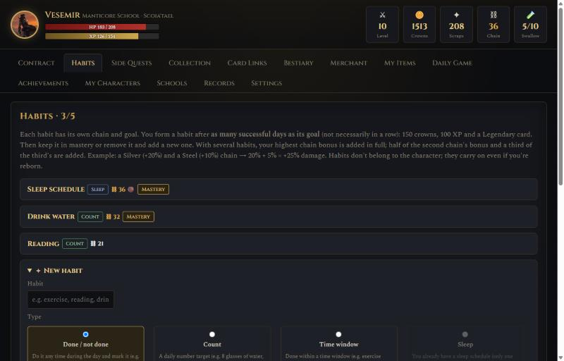
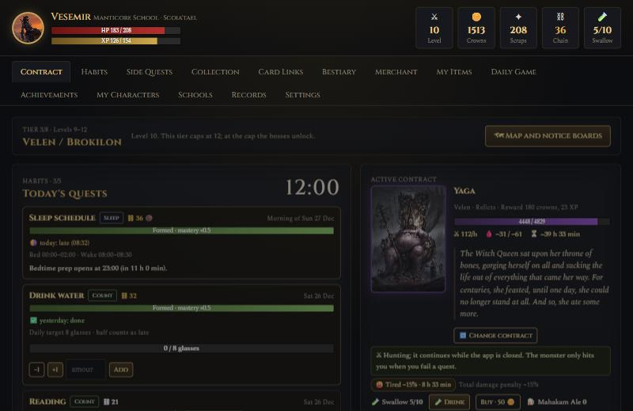
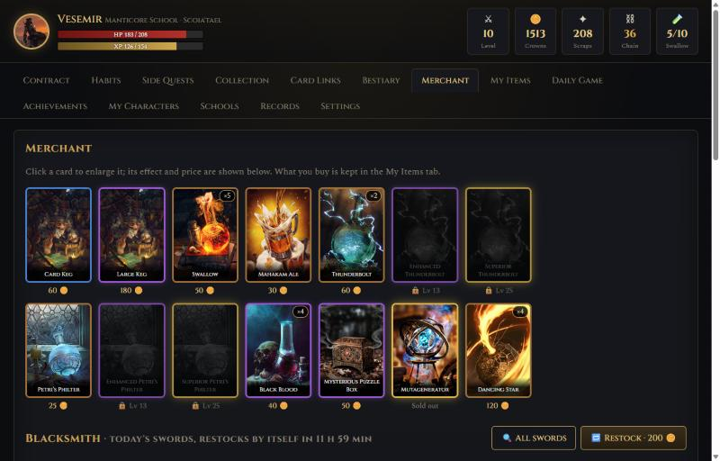
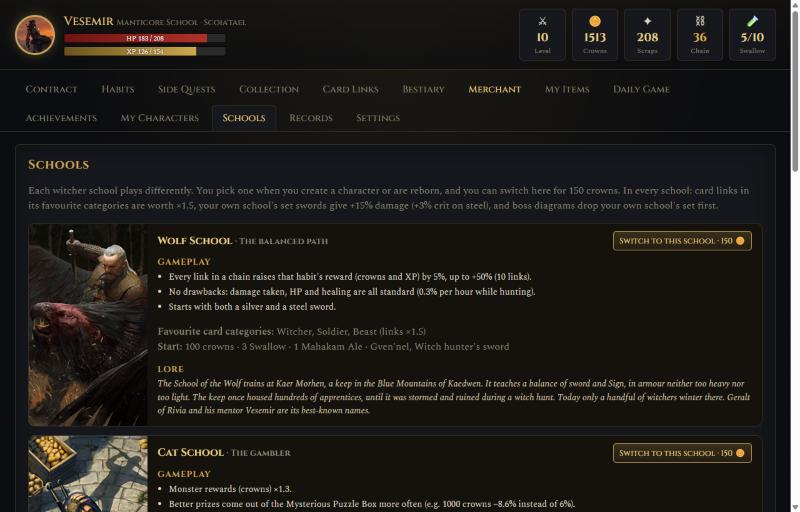
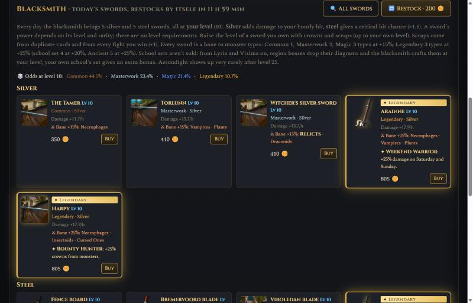
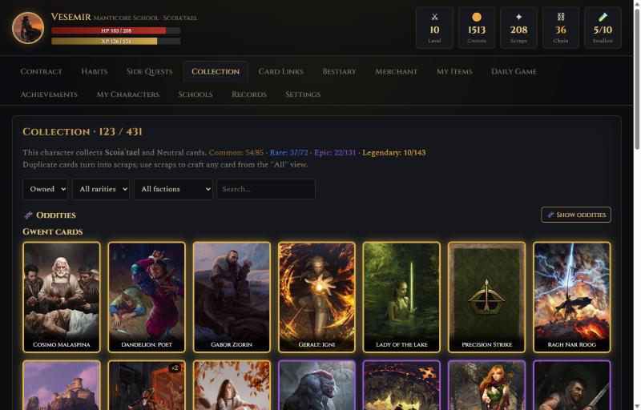
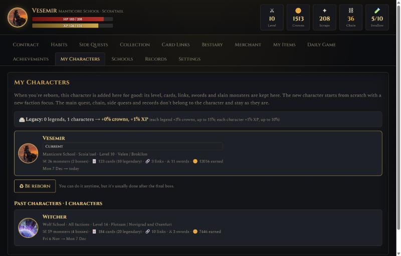
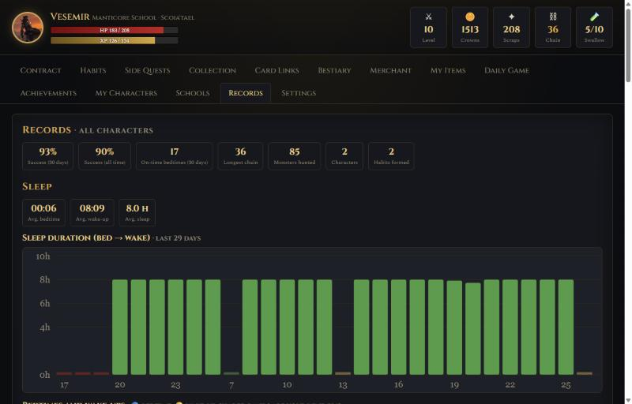

# Habits of Witchers

A Witcher-themed habit tracker that turns your daily habits into a monster hunt. It runs on your own computer, in your browser.

Keep your habits and your witcher grows stronger, earns crowns and collects Gwent cards. Skip them and the monster you are hunting strikes back.

*Türkçe açıklama aşağıda.*

> **Unofficial fan project.** Not affiliated with or endorsed by CD PROJEKT RED. Non-commercial; no money is made from it in any way. The Witcher, Gwent and all related names, card art and texts are the property of CD PROJEKT S.A.

## How it works

### Habits



- You can track up to **5 habits** at once. Each one is a quest lasting 14–60 days.
- There are four kinds of habit:
  - **Sleep:** a bedtime window and a wake-up window.
  - **Time window:** do it between two times (for example 07:00–08:00).
  - **Count:** reach a daily number (for example 8 glasses of water).
  - **Done / not done:** a checklist of up to 20 sub-tasks.
- **On time** counts as a success: you get crowns, XP and Gwent cards.
- **Late** gives you a "rusty" link and makes you *Tired* (−15% damage for 12 hours).
- **Missed** breaks the chain and makes you *Exhausted* (−30% damage for 24 hours).
- Missed a day only because the app was closed? You can still enter it within 24 hours, and the penalty is undone.
- Once a week you can announce a **rest day** in advance. Your chains freeze that day, with no penalty.

### Chains
- Every success adds a link to that habit's chain. Longer chains give bigger rewards and more damage:
  - Iron: 0 links, +0%
  - Steel: 7 links, +10%
  - Silver: 14 links, +20%
  - Gold: 30 links, +30%
  - Mithril: 40 links, +50%
  - Meteorite: 60 links, +100%
- With several habits, your best chain counts in full, the second counts half, the third a third, and so on.
- A broken chain drops one tier. Succeed on the next 2 days (**atonement**) and the lost links come back.

### The hunt



- You always have a contract on a monster, and your witcher fights it **every hour**, even while the app is closed.
- **Hourly damage** = (your level's power + silver sword) × (chains + card links + sword bonuses). A steel sword adds a chance of a critical hit (×1.5).
- Monsters never attack on their own. They hit you **only when you are late (half a hit) or miss a habit (a full hit)**.
- Running out of HP means defeat: the monster heals to full, you lose 10% of your crowns, and you recover for a few hours.
- Below 50% HP you are *Wounded* (−20% damage).
- **The map:** 16 regions across 8 tiers (levels 1–32), with about 200 monsters, from White Orchard to Toussaint.
  - Each region has a notice board with 5 contracts. You can switch contracts at any time, but the old one loses its progress.
  - When you reach a tier's level cap, its bosses open up. Killing one unlocks the next tier.
- **After the final boss** your character becomes a legend. Slain monsters return as stronger elites, and XP past level 32 earns Renown (★).

### Potions and bombs



The merchant restocks daily: 3 of each potion and bomb (Thunderbolt: 3 per grade), 1 Petri’s Philter, 5 Puzzle Boxes. You can carry at most 5 of each.

| Item | Effect | Price |
|---|---|---|
| Swallow | Heals 50% of your max HP | 100 |
| Mahakam Ale | Drink it while Exhausted: Exhausted ends, but you're drunk for 24 h (monster hits ×2) | 40 |
| Thunderbolt | +20% damage for 24 hours (Enhanced +30% from level 13: 300 · Superior +40% from level 25: 600). Doesn't stack | 120 |
| Petri’s Philter | +10 XP, drunk on purchase (Enhanced +20 XP: 150 · Superior +35 XP: 350). One a day | 50 |
| Dancing Star (bomb) | Hits the monster for 3–10 hours' worth of your damage; 48-hour cooldown between throws | 120 |

### Witcher schools



Each school changes how you play:

| School | Strength |
|---|---|
| **Wolf** | Balanced: each link in a chain adds +5% to that habit's rewards (up to +50%) |
| **Cat** | Gambler: monster rewards ×1.3, better Puzzle Box prizes more often, daily game reward ×1.5; but you take ×1.5 damage |
| **Bear** | Tough: ×1.4 HP, ×0.6 damage taken, and faster healing |
| **Griffin** | Disciplined: atonement takes 1 day, and you never become Tired or Exhausted |
| **Viper** | Punctual: do a habit early for ×1.4 rewards and +10% damage for 24 hours |
| **Manticore** | Alchemist: potions cost half, and Dancing Star hits 30% harder |

Each school also has 3 favourite card categories. Card links in those categories are worth ×1.5. The Schools tab in the app explains each school's mechanics and lore.

### Swords



- Every day the blacksmith sells 5 silver and 5 steel swords, all at **your level**.
  - Silver swords add damage; steel swords add critical-hit chance.
  - Higher levels bring rarer swords more often.
  - A sword you buy is not replaced until the next day, or until you pay to restock.
- You can raise a sword's level with crowns and scraps, up to your own level.
- **Bane bonus:** every sword deals extra damage to certain monster types. Rarer swords cover more types or hit harder:
  - Common: 1 type, +15%
  - Masterwork: 2 types, +15%
  - Magic: 3 types, +15%
  - Legendary: 3 types, +25%
- **Unique traits:** every Legendary sword has its own trait, and no two swords share one. Examples: more damage at night, crits that deal ×2, extra cards from kills, surviving a killing blow once a week. Legendary swords cost 50% more.
- **Aerondight:** very rare (from level 25, a 1% daily chance at the blacksmith).
  - It gains a charge for every 24 hours of fighting, up to +100% damage.
  - Being late loses half the charge; missing a day loses all of it.
  - At full charge, every 12th hit deals 12 hours of damage.
- **School sets:** from tier 2 on, bosses drop diagrams for witcher school gear, which the blacksmith can craft.

### Gwent cards



- You earn cards from habits, kills, chain milestones and kegs bought from the merchant.
- Focus on one faction to complete its collection faster, or collect from all of them.
- **Card links:** 5 cards from the same faction and category form a link that adds permanent damage. You can have up to 10 links.
- Duplicate cards turn into scraps. Scraps craft missing cards and upgrade swords.

### My Characters



After the final boss you can be **reborn** as a new character. The old one moves to the My Characters tab and gives every future character a bonus:
- +3% crowns for each legend (up to 15%)
- +1% XP for each character (up to 10%)

### Also



- Achievements and a weekly summary, plus sleep charts.
- Sound effects.
- **Phone access:** open the app from a phone on the same Wi-Fi, with an optional PIN.
- English and Turkish (Settings → Language). The app starts in English unless your browser is set to Turkish.
- **Fully local:** your data stays on your computer, in a single SQLite file.

## Running it

You only need **Python 3.9+**. No extra packages.

1. Download the repository.
2. **Windows:** double-click `Start.bat`.
   **macOS / Linux:** run `python3 server.py`.
3. Card texts (`cards.js`, `cards-info.json`) come with the repository. To refresh them from gwent.one, run:
   ```
   python3 tools/fetch_cards.py
   ```
4. Your browser opens `http://localhost:8642`. The app works as long as the server window stays open.
5. (Optional) Images are saved the first time they are shown, so later they work offline. To download them all at once:
   ```
   python3 tools/cache_images.py        (add --all for medium card art too)
   ```

- **Test mode:** `Test.bat` (or `python3 server.py --open "?slot=test"`) opens a separate test save. There you can fast-forward time and try anything without touching your real save.
- **Automated tests:** `http://localhost:8642/tests.html`
- **Your data:** `hofw.db`, with daily backups in `backups/`. These files are kept out of the repository by `.gitignore`.

## Files

| File | Contents |
|---|---|
| `server.py` | Python standard-library server: static files and a JSON API, SQLite, backups, phone access |
| `engine.js` | Game rules (no DOM, pure logic) |
| `app.js`, `index.html`, `style.css` | User interface |
| `monsters.js`, `swords.js` | Regions, monsters and swords (balance values) |
| `tools/fetch_cards.py` | Downloads card data from gwent.one and rebuilds `cards.js` and `cards-info.json` |
| `tools/build_swords.py` | Builds `swords.js` |
| `imgcache.py`, `tools/cache_images.py` | Image cache (`hofw-gorsel.db`) and bulk download |
| `tests.js`, `tests.html` | In-browser tests and balance simulation |

## Credits

- Card data and art: [gwent.one](https://gwent.one). Card texts are included in the repository; card art is loaded at runtime and not redistributed.
- Sword images: [The Witcher Wiki](https://witcher.fandom.com) and [witcherdb.com](https://witcherdb.com) (loaded at runtime).
- Manticore School artwork: provided by the project author.
- The Witcher and Gwent © CD PROJEKT S.A.

## License

The source code is MIT licensed (see `LICENSE`). The license does not apply to any CD PROJEKT RED material.

---

# Türkçe

Günlük alışkanlıklarını bir canavar avına çeviren, Witcher temalı bir alışkanlık takipçisi. Kendi bilgisayarında, tarayıcıda çalışır.

Alışkanlıklarını sürdürürsen witcher'ın güçlenir, oren kazanır ve Gwent kartları toplar. Aksatırsan peşinde olduğun canavar sana vurur.

> **Resmi olmayan hayran projesi.** CD PROJEKT RED ile bağlantısı yoktur, ticari değildir ve hiçbir şekilde para kazanılmaz. The Witcher, Gwent ve ilgili isimler, kart görselleri ve metinler CD PROJEKT S.A.'ya aittir.

## Nasıl çalışır

### Alışkanlıklar


- Aynı anda en fazla **5 alışkanlık** takip edebilirsin. Her biri 14–60 gün süren bir görevdir.
- Dört tür alışkanlık var:
  - **Uyku:** bir yatış aralığı ve bir kalkış aralığı.
  - **Saat aralığı:** iki saat arasında yap (örneğin 07:00–08:00).
  - **Adet:** günlük bir sayıya ulaş (örneğin 8 bardak su).
  - **Yaptım / yapmadım:** en fazla 20 alt görevli bir liste.
- **Zamanında** yaparsan başarı sayılır: oren, TP ve Gwent kartı kazanırsın.
- **Geç kalırsan** zincire "paslı" bir halka eklenir ve *Yorgun* olursun (12 saat hasar −%15).
- **Kaçırırsan** zincir kırılır ve *Bitkin* olursun (24 saat hasar −%30).
- Bir günü sadece uygulama kapalı olduğu için mi kaçırdın? 24 saat içinde sonradan girebilirsin; ceza geri alınır.
- Haftada bir gün önceden **dinlenme günü** ilan edebilirsin. O gün zincirlerin donar, ceza yoktur.

### Zincirler
- Her başarı o alışkanlığın zincirine bir halka ekler. Zincir uzadıkça ödül ve hasar artar:
  - Demir: 0 halka, +%0
  - Çelik: 7 halka, +%10
  - Gümüş: 14 halka, +%20
  - Altın: 30 halka, +%30
  - Mithril: 40 halka, +%50
  - Göktaşı: 60 halka, +%100
- Birden fazla alışkanlıkta en iyi zincirin tam, ikincisi yarım, üçüncüsü üçte bir sayılır, sonrakiler de azalarak.
- Kırılan zincir bir kademe düşer. Sonraki 2 günü başarırsan (**kefaret**) kaybolan halkalar geri gelir.

### Av


- Her zaman bir canavarla kontratın vardır ve witcher'ın onunla **her saat** savaşır, uygulama kapalıyken bile.
- **Saatlik hasar** = (seviyenin gücü + gümüş kılıç) × (zincirler + kart bağları + kılıç bonusları). Çelik kılıç kritik vuruş şansı ekler (×1,5).
- Canavarlar kendiliğinden saldırmaz. Sana **sadece geç kaldığında (yarım vuruş) ya da bir alışkanlığı kaçırdığında (tam vuruş)** vururlar.
- Canın biterse yenilirsin: canavarın canı dolar, orenin %10'unu kaybedersin ve birkaç saat toparlanırsın.
- Canın %50'nin altındayken *Yaralısın* (hasar −%20).
- **Harita:** 8 kademede 16 bölge (seviye 1–32), White Orchard'dan Toussaint'e yaklaşık 200 canavar.
  - Her bölgenin 5 kontratlık bir ilan panosu var. Kontratını istediğin zaman değiştirebilirsin, ama eskisinin ilerlemesi sıfırlanır.
  - Kademenin seviye sınırına gelince boss'ları açılır. Birini öldürmek sonraki kademeyi açar.
- **Son boss'tan sonra** karakterin efsane olur. Kestiğin canavarlar daha güçlü elitler olarak geri döner, 32. seviyeden sonraki TP Ün (★) kazandırır.

### İksirler ve bombalar


Tüccarın stoğu her gün yenilenir: her iksir ve bombadan 3 (Thunderbolt'ta kademe başına 3), 1 Petri’s Philter, 5 Puzzle Box. Her birinden üzerinde en fazla 5 tane taşıyabilirsin.

| Eşya | Etkisi | Fiyat |
|---|---|---|
| Swallow | En yüksek canın %50'si | 100 |
| Mahakam Ale | Bitkinken içilir: Bitkin geçer ama 24 saat sarhoşsun (canavar vuruşları ×2) | 40 |
| Thunderbolt | 24 saat hasar +%20 (Gelişmiş +%30, 13. seviyeden: 300 · Üstün +%40, 25. seviyeden: 600). Üst üste binmez | 120 |
| Petri’s Philter | Alınınca hemen içilir: +10 TP (Gelişmiş +20 TP: 150 · Üstün +35 TP: 350). Günde bir tane | 50 |
| Dancing Star (bomba) | Canavara 3–10 saatlik hasarın kadar vurur; iki atış arasında 48 saat bekleme | 120 |

### Witcher okulları


Her okul oyun tarzını değiştirir:

| Okul | Gücü |
|---|---|
| **Wolf** | Dengeli: zincirdeki her halka o alışkanlığın ödülüne +%5 ekler (en çok +%50) |
| **Cat** | Kumarbaz: canavar ödülleri ×1,3, Puzzle Box'ta iyi ödüller daha sık, günlük oyun ödülü ×1,5; ama aldığın hasar ×1,5 |
| **Bear** | Dayanıklı: can ×1,4, aldığın hasar ×0,6, daha hızlı iyileşme |
| **Griffin** | Disiplinli: kefaret 1 gün sürer, ne Yorgun ne Bitkin olursun |
| **Viper** | Dakik: alışkanlığı erken yaparsan ödül ×1,4 ve 24 saat hasar +%10 |
| **Manticore** | Simyacı: iksirler yarı fiyatına, Dancing Star %30 daha sert vurur |

Her okulun 3 sevdiği kart türü de vardır. Bu türlerdeki kart bağları ×1,5 değerlidir. Uygulamadaki Okullar sekmesi her okulun oynanışını ve hikâyesini anlatır.

### Kılıçlar


- Demirci her gün 5 gümüş ve 5 çelik kılıç satar, hepsi **senin seviyende**.
  - Gümüş kılıçlar hasar, çelik kılıçlar kritik şansı ekler.
  - Seviye yükseldikçe nadir kılıçlar daha sık çıkar.
  - Satın aldığın kılıcın yerine ertesi güne kadar, ya da para verip stoğu yenileyene kadar, yenisi gelmez.
- Kılıcının seviyesini oren ve kırıntıyla, kendi seviyene kadar yükseltebilirsin.
- **Avcı bonusu:** her kılıç belirli canavar türlerine ek hasar verir. Nadir kılıçlar daha çok türü kapsar ya da daha sert vurur:
  - Sıradan: 1 tür, +%15
  - Usta işi: 2 tür, +%15
  - Büyülü: 3 tür, +%15
  - Efsanevi: 3 tür, +%25
- **Benzersiz özellikler:** her Efsanevi kılıcın kendine ait bir özelliği vardır, iki kılıç aynı özelliği taşımaz. Örnekler: gece daha çok hasar, ×2 kritik, öldürmelerden ek kart, haftada bir ölümcül darbeden kurtulma. Efsanevi kılıçlar %50 daha pahalıdır.
- **Aerondight:** çok nadirdir (25. seviyeden itibaren demircide günlük %1 şans).
  - Her 24 saatlik savaşta bir şarj kazanır, en çok +%100 hasara kadar.
  - Geç kalmak şarjın yarısını, bir günü kaçırmak hepsini götürür.
  - Şarj tamken her 12. vuruş 12 saatlik hasar vurur.
- **Okul setleri:** 2. kademeden itibaren boss'lar witcher okulu teçhizatı şemaları düşürür; bunları demirciye yaptırabilirsin.

### Gwent kartları


- Kartları alışkanlıklardan, öldürmelerden, zincir eşiklerinden ve tüccardan alınan fıçılardan kazanırsın.
- Bir fraksiyona odaklanıp koleksiyonunu daha hızlı tamamlayabilir ya da hepsinden toplayabilirsin.
- **Kart bağları:** aynı fraksiyon ve türden 5 kart, kalıcı hasar ekleyen bir bağ kurar. En fazla 10 bağın olabilir.
- Tekrar gelen kartlar kırıntıya dönüşür. Kırıntıyla eksik kartları üretir, kılıç yükseltirsin.

### Karakterlerim


Son boss'tan sonra yeni bir karakter olarak **yeniden doğabilirsin**. Eski karakter Karakterlerim sekmesine taşınır ve sonraki bütün karakterlere bonus verir:
- Her efsane için +%3 oren (en çok %15)
- Her karakter için +%1 TP (en çok %10)

### Ayrıca


- Başarımlar ve haftalık özet, ayrıca uyku grafikleri.
- Ses efektleri.
- **Telefondan erişim:** aynı Wi‑Fi'deki bir telefondan açabilirsin, istersen PIN'le.
- Türkçe ve İngilizce (Ayarlar → Dil).
- **Tamamen yerel:** verilerin kendi bilgisayarında, tek bir SQLite dosyasında durur.

## Kurulum

Gereken tek şey **Python 3.9+**. Ek paket yok.

1. Depoyu indir.
2. **Windows:** `Start.bat` dosyasına çift tıkla.
   **macOS / Linux:** `python3 server.py` çalıştır.
3. Kart metinleri (`cards.js`, `cards-info.json`) depoyla birlikte gelir. gwent.one'dan güncellemek istersen çalıştır:
   ```
   py -3 tools/fetch_cards.py        (macOS/Linux: python3 tools/fetch_cards.py)
   ```
4. Tarayıcı `http://localhost:8642` adresinde açılır. Sunucu penceresi açık kaldığı sürece uygulama çalışır.
5. (İsteğe bağlı) Görseller ilk gösterildiklerinde kaydedilir, sonra internetsiz de görünür. Hepsini bir kerede indirmek için:
   ```
   py -3 tools/cache_images.py       (kartların orta boy görselleri için: --all)
   ```

- **Test modu:** `Test.bat` (ya da `python3 server.py --open "?slot=test"`) ayrı bir test kaydı açar. Orada zamanı ileri sarıp gerçek kaydına dokunmadan her şeyi deneyebilirsin.
- **Otomatik testler:** `http://localhost:8642/tests.html`
- **Verilerin:** `hofw.db`; günlük yedekler `backups/` klasöründe. Bu dosyalar `.gitignore` ile depodan hariç tutulur.

## Lisans

Kaynak kod MIT lisanslıdır (`LICENSE` dosyasına bak). Lisans, CD PROJEKT RED'e ait hiçbir materyali kapsamaz.
